<!-- header:start -->
<div align="center">



<a href="#-quick-start"></a>

<a href="LICENSE"></a>

<a href="https://github.com/ajendras/fuzz-forge/stargazers"></a>
<a href="https://github.com/ajendras/fuzz-forge/actions/workflows/ci.yml"></a>

<a href="CONTRIBUTING.md"></a>

**AI-powered API fuzzing library that intelligently generates security tests from OpenAPI and GraphQL specs using local LLMs**

[✨ Features](#-features) • [⚡ Quick start](#-quick-start) • [🧰 Usage](#-usage) • [🧩 Architecture](#-architecture) • [📍 Roadmap](#-roadmap) • [🤝 Contributing](#-contributing)

</div>
<!-- header:end -->

## ✨ Why Fuzz Forge?

Traditional random fuzzers blast APIs with noise but miss context-aware logic flaws, semantic bugs, and business-specific attack paths. Fuzz Forge closes the gap by using local LLMs (via Ollama) to *understand* your OpenAPI or GraphQL spec and generate high-signal security tests for injection, auth bypasses, IDOR, and logic issues. Built for security engineers, backend teams, and pentesters who want fast, private, repeatable API hardening.

- **Contextual intelligence** — the LLM respects endpoint purpose and schema instead of throwing garbage
- **Fully local & private** — no data leaves your machine; works offline with any Ollama model
- **Smart mutation engine** — turns one LLM idea into targeted XSS, SQLi, auth, logic, and GraphQL-specific variants
- **First-class auth support** — parser understands OAuth2 flows and apiKey locations; executor automatically injects provided credentials for realistic testing (skips auth_bypass tests)
- **Safe-by-default** — dry-run mode, host allowlists, rate limits, and non-destructive actions only
- **Ready for CI** — rich HTML/JSON reports with curl repro steps and risk scores
- **SARIF output** — direct integration with the GitHub Security tab (results.sarif.json)

## 🎬 Demo

<p align="center"></p>

## 🚀 Features

<table>
<tr>
<td align="center" width="33%">
🧩 <b>OpenAPI & GraphQL Import</b><br>
Parses specs (including GraphQL SDL) into executable test plans with endpoint semantics
</td>
<td align="center" width="33%">
🧠 <b>Local LLM Gen</b><br>
Queries Ollama to craft targeted payloads that respect your schema
</td>
<td align="center" width="33%">
⚡ <b>Smart Mutations</b><br>
Applies XSS, SQLi, IDOR, auth, logic and GraphQL mutation mutators with context
</td>
</tr>
<tr>
<td align="center" width="33%">
🏃 <b>Async Runner</b><br>
Executes tests in parallel while enforcing safe rate limits
</td>
<td align="center" width="33%">
📊 <b>Rich Reports</b><br>
Interactive HTML (request/response viewers + one-click replay), JSON, SARIF, curl repros
</td>
<td align="center" width="33%">
🛠️ <b>Extensible</b><br>
Simple base classes let you drop in custom mutators or detectors
</td>
</tr>
<tr>
<td align="center" width="33%">
🛡️ <b>Safe Defaults</b><br>
Dry-run mode, host allowlists and non-destructive actions only
</td>
<td align="center" width="33%">
🔁 <b>Replay Suite</b><br>
Saves failing cases for regression testing in CI
</td>
<td></td>
</tr>
</table>

## 📦 Installation

**Requirements**: Python 3.10+, Ollama running locally with a model pulled (`ollama pull llama3.2`).

```bash
pip install fuzz-forge
```

Verify the CLI:

```bash
fuzzforge --help
```

## ⚡ Quick start

```python
from fuzzforge import scan

# One-liner: parse, generate LLM-powered tests, run (dry-run by default)
results = scan(
    spec_path="examples/petstore.yaml",
    model="llama3.2",
    limit=15,
    dry_run=True
)

for result in results:
    if result.is_vulnerable:
        print(result.repro_curl)
        print("Risk:", result.risk_score)
```

GraphQL is supported out of the box (auto-detected by `.graphql`/`.gql` extension or content):

```python
results = scan(
    spec_path="schema.graphql",  # or introspection JSON
    model="llama3.2",
    limit=15,
    dry_run=True
)
```

After scanning, `fuzz-reports/report.html` is an interactive report with request/response viewers and one-click replay. JSON, SARIF and individual repro scripts are also produced and can be uploaded to GitHub (see [GitHub documentation](https://docs.github.com/en/code-security/code-scanning/integrating-with-code-scanning/uploading-a-sarif-file-to-github) for upload options).

## 🧰 Usage

**CLI scan with retro banner** (recommended for most users):

```bash
fuzzforge scan petstore.yaml --model llama3.2 --limit 20 --dry-run
```

Generate a project config (creates `fuzzforge.toml` with safe defaults):

```bash
fuzzforge init petstore.yaml
```

**Direct library usage with full control**:

```python
from fuzzforge.core import FuzzForge

forge = FuzzForge(
    model="llama3.2",
    mutators=["injection", "auth_bypass"],
    dry_run=True,
    rate_limit_rps=3.0,
    allowed_hosts=["localhost", "127.0.0.1"],
    api_key="demo-key-123",
    bearer_token="eyJhbGciOiJIUzI1NiIsInR5cCI6IkpXVCJ9.demo",
)

forge.from_spec("petstore.yaml")
tests = forge.generate(limit=12)
results = forge.run(tests)

# results contain TestResult objects with .risk_score, .findings, .repro_curl
```

The generated `fuzz-reports/report.html` is fully interactive: click any test row to open a pixel-perfect modal with separate request and response viewers (formatted headers/payloads), risk scoring, and one-click replay buttons (copy cURL or send live request via browser fetch with safety warning).

<details><summary>Advanced: Custom mutator (see examples/custom_mutator.py)</summary>

```python
from fuzzforge.mutators import Mutator
from fuzzforge.core import TestCase

class DomainSpecificMutator(Mutator):
    name = "domain_specific"
    def apply(self, test: TestCase):
        mutated = test.model_copy(deep=True)
        mutated.tags.append("domain_specific")
        mutated.payload["admin_override"] = True
        mutated.description += " (custom domain logic)"
        return mutated

# Register and use
forge = FuzzForge(mutators=["injection", "domain_specific"])
```
</details>

<details><summary>Advanced: Load config and replay saved tests</summary>

After a scan, `fuzz-reports/` contains the interactive HTML, JSON results, SARIF, and curl repro files. Load them for regression:

```python
from fuzzforge.reporter import Reporter
reporter = Reporter()
# replay logic can be built with the saved TestCase JSON
```
</details>

## 🔧 Configuration

Fuzz Forge reads `fuzzforge.toml` (generated by `fuzzforge init`). All values have safe defaults.

| Option              | Default               | Description |
|---------------------|-----------------------|-----------|
| model               | "llama3.2"            | Ollama model identifier (must be pulled locally) |
| limit               | 20                    | Maximum test cases generated per endpoint |
| dry_run             | true                  | Simulate execution only (recommended first run) |
| rate_limit_rps      | 5.0                   | Requests per second when executing live |
| allowed_hosts       | ["localhost", "127.0.0.1", "example.com"] | Hosts permitted for real HTTP traffic |
| enabled_mutators    | ["injection", "auth_bypass", "logic", "graphql_mutation"] | Mutators to enable (or "all") |
| output_dir          | "fuzz-reports"        | Directory for HTML, JSON, SARIF, and curl repro files |
| api_key             | None                  | API key used by executor for apiKey security schemes (skipped for auth_bypass tests) |
| bearer_token        | None                  | Bearer token used by executor for OAuth2 / HTTP Bearer schemes (skipped for auth_bypass tests) |

The `reporting.formats` array now supports `sarif` (enabled by default). The HTML report is always interactive.

## 🧩 Architecture

```mermaid
flowchart TD
    Spec[OpenAPI or GraphQL Spec<br/>petstore.yaml or schema.graphql] --> Parser[parser.py<br/>OpenAPIParser.parse (OpenAPI + GraphQL)]
    Parser --> Core[core.py<br/>FuzzForge.from_spec]
    Core --> LLM[llm.py<br/>LLMClient.generate_tests]
    LLM --> TC[TestCase]
    TC --> Mutators[mutators.py<br/>InjectionMutator / AuthBypassMutator / LogicMutator / GraphQLMutator]
    Mutators --> TC2[TestCase (mutated)]
    TC2 --> Executor[executor.py<br/>TestExecutor.run_all]
    Executor --> Results[TestResult]
    Results --> Reporter[reporter.py<br/>HTML + JSON + SARIF + curl repros]
    Core -.-> Executor
    Core -.-> Reporter
```

FuzzForge is the central orchestrator. It loads a spec via `parser.py` (now with first-class extraction of OAuth2 and apiKey security schemes plus full GraphQL SDL support with mutation focus), asks the local LLM for contextual base tests (prompts now include security schemes and GraphQL-specific guidance), expands them with mutators (including a dedicated GraphQL mutation mutator for argument injection, batching, and DoS patterns), executes safely with automatic credential injection in `executor.py` (dry-run or rate-limited HTTP, respects auth_bypass tests), then hands results to the reporter for retro-styled HTML output.

## 📁 Project structure

```text
.
├── src/fuzzforge/
│   ├── __init__.py          # Public API: FuzzForge, scan(), TestCase, TestResult
│   ├── cli.py               # Typer CLI with 8-bit rich banner and commands (scan, init)
│   ├── core.py              # FuzzForge orchestrator + APISpec/TestCase/TestResult models
│   ├── parser.py            # OpenAPIParser using prance (v2/v3 support) + GraphQL SDL via graphql-core
│   ├── llm.py               # LLMClient (prompt building, JSON extraction, fallback tests)
│   ├── mutators.py          # Mutator base + InjectionMutator, AuthBypassMutator, LogicMutator, GraphQLMutator + get_mutators()
│   ├── executor.py          # TestExecutor with async httpx, rate limiting, host allowlist, dry-run
│   ├── reporter.py          # HTML (Press Start 2P pixel style), JSON, SARIF, curl repro files
│   └── ...
├── examples/
│   ├── basic.py             # Runnable demo using scan() on a petstore spec
│   └── custom_mutator.py    # Example subclassing Mutator for domain-specific tests
├── tests/test_fuzzforge.py  # Pytest suite (mocked LLM, mutator validation, scanning pipeline)
├── config.example.toml      # Full configuration reference with safe defaults
├── pyproject.toml           # Dependencies, CLI entrypoint, pytest/ruff config
└── README.md
```

## 🧪 Testing

```bash
pytest
```

The suite covers the full scanning pipeline (`scan()` and `FuzzForge`), mocked Ollama responses, mutator output validation, Pydantic model integrity, error handling, and fallback paths when the LLM is unavailable. New tests validate OAuth2/apiKey parsing, credential injection, bypass-test skipping, SARIF output correctness, the interactive HTML report (modal viewers, JS replay, clipboard), **GraphQL schema parsing, GraphQLMutator behaviour, and tailored LLM prompt generation for mutations**.

## 📍 Roadmap
<!-- roadmap:start -->
- [x] **v0.1.0** — first release: OpenAPI Import, Local LLM Gen, Smart Mutations, Async Runner
- [x] Add first-class OAuth2 / API-key auth scheme support in parser and executor
- [x] Implement SARIF output for direct GitHub Security tab integration
- [x] Add interactive HTML report with request/response viewers and one-click replay
- [x] Support GraphQL schemas and mutation generation
- [ ] Auto-detect rate limits from response headers and back off dynamically
- [ ] Create pytest plugin for seamless test-suite integration
- [ ] Add plugin system for community mutators loaded from entrypoints
- [ ] Support exporting test suites as standalone curl scripts or Postman collections
- [ ] Include a tiny local mock server for safe offline testing of generated cases
- [ ] Improve LLM prompts with few-shot examples for higher-quality edge cases
- [ ] Add gRPC protobuf parsing and fuzzing support
- [ ] Provide pre-built Docker image with Ollama for one-command CI usage

> 🤖 This roadmap is worked through continuously — ideas and PRs welcome!
<!-- roadmap:end -->

## 🤝 Contributing

We love pixel-perfect contributions! Whether it's a new mutator, better prompt engineering, retro HTML improvements, or documentation, please join in.

See [CONTRIBUTING.md](https://github.com/ajendras/fuzz-forge/blob/main/CONTRIBUTING.md) and our [Code of Conduct](https://github.com/ajendras/fuzz-forge/blob/main/CODE_OF_CONDUCT.md). Good first issues are tagged and make perfect starter PRs.

## 📄 License

MIT © Fuzz Forge Maintainers. See [LICENSE](LICENSE) for details.

<!-- footer:start -->
<div align="center">

### ⭐ Star history

<a href="https://star-history.com/#ajendras/fuzz-forge&Date"></a>

If **Fuzz Forge** saves you time, a ⭐ helps others find it.

Made with ❤️ by [Ajendra](https://ajendra.info)


</div>
<!-- footer:end -->
